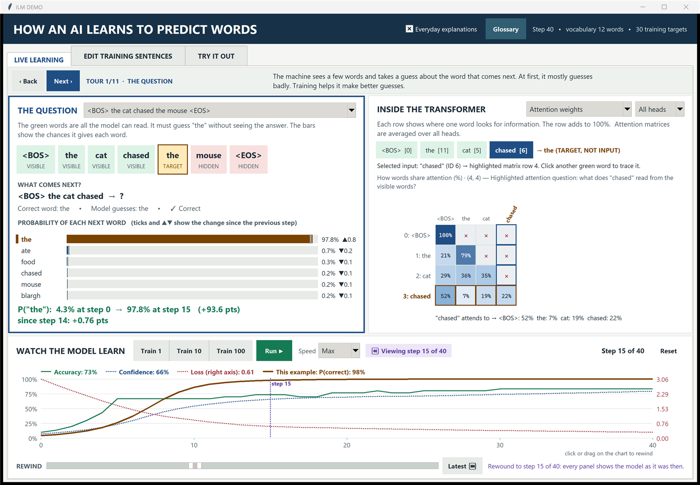
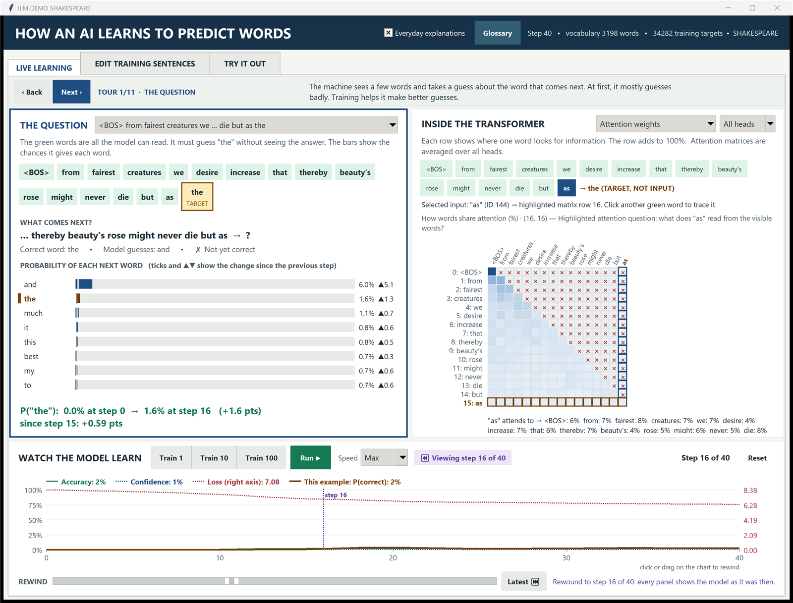

# Inside the Learning Machine

A hands-on, step-by-step course on how a GPT-style language model learns to predict the next word,
built around one interactive desktop exhibit and a handful of short PyTorch scripts.

The main program, `inside_learning_machine.py`, trains a real (tiny) transformer in front of you.
You can watch every tensor change as it trains, rewind to any earlier training step, and compare what the
model believed then with what it believes now.



## What is in this repository

| File | What it is |
|---|---|
| `inside_learning_machine.py` | The interactive exhibit (Tkinter + PyTorch, single file). Start here. |
| `lesson_01_attention.py` | Attention by hand: three tokens, fixed Q/K/V matrices, softmax weights. |
| `lesson_02_trainable_attention.py` | The same idea with learned projections and a small vocabulary. |
| `lesson_03_train_gpt.py` | A complete MiniGPT trained on five sentences, with next-word prediction and text generation. |
| `lesson_06_multihead.py` | Causal multi-head attention with a verified KV cache. |
| `mini_gpt_visualizer.py` | An earlier step-through tracer of one forward pass, with the source line for each operation highlighted. |
| `shakespeare_sonnets_154.txt` | Project Gutenberg eBook #1041, cached so the exhibit works offline. |
| `pyproject.toml`, `uv.lock` | Dependencies (PyTorch, NumPy) pinned for `uv`. |

## Step 1: install the prerequisites

1. **Python 3.14** is required by `pyproject.toml`. You do not need to install it yourself if you use `uv`; `uv` will fetch it.
2. **Install `uv`**, the Python package manager that handles everything else.
   - Windows (PowerShell):
     ```powershell
     powershell -ExecutionPolicy ByPass -c "irm https://astral.sh/uv/install.ps1 | iex"
     ```
   - macOS / Linux:
     ```bash
     curl -LsSf https://astral.sh/uv/install.sh | sh
     ```
   Full instructions: https://docs.astral.sh/uv/getting-started/installation/
3. **Tkinter** ships with the python.org installers on Windows and macOS. On Debian/Ubuntu install it with:
   ```bash
   sudo apt install python3-tk
   ```

A GPU is optional. The project pins PyTorch's CUDA 12.8 wheel index, which also runs on the CPU.
The first download is large (a few gigabytes); after that everything is cached.

## Step 2: get the code

```bash
git clone https://github.com/petershk/attention-is-all-you-need.git
cd attention-is-all-you-need
```

## Step 3: run the exhibit

```bash
uv run python inside_learning_machine.py
```

The first run creates a virtual environment and downloads PyTorch. Later runs start in a second or two.

If you run it with a plain `python inside_learning_machine.py` and PyTorch is missing, the script relaunches
itself through `uv run` automatically. If `uv` is not installed it tells you how to get it.

On start the exhibit loads all 154 Shakespeare sonnets from the cached text file and builds a model over
a 3,198-word vocabulary. If the file is missing it downloads it once from Project Gutenberg, and if that
fails it falls back to five short example sentences and tells you why.

## Step 4: take the guided tour

The strip under the tabs is an 11-stop tour. Press **Next ›** to move through it. Each stop:

- selects the matching tensor in the INSIDE THE TRANSFORMER panel,
- outlines the panel you should be looking at in blue,
- explains what is happening in everyday words (untick **Everyday explanations** in the header for the
  technical version plus the line of PyTorch that does it).

The tour order follows the data: token IDs, embeddings, Q, scores, the causal mask, attention weights,
attention output, the MLP, probabilities, and finally the weight update.

## Step 5: read the three panels

**THE QUESTION** (left). Pick a training example from the dropdown. Green cards are the words the model
is allowed to see, the gold card is the word it must predict, red cards are the future it must not see.
Click any card to move the prediction point. The bars show the probability the model gives each candidate
word. Small ticks and ▲▼ markers show how each bar moved since the previous training step.

**INSIDE THE TRANSFORMER** (right). Choose a tensor and, for per-head tensors, a head. Click a green chip
to trace that word's row through the matrix. Non-negative tensors (attention weights, probabilities) use a
light-to-dark ramp; signed tensors use red for negative and blue for positive; masked cells are grey with a ×.

**WATCH THE MODEL LEARN** (bottom). Four curves over training steps: accuracy, confidence, loss (right
axis) and, in gold, the probability of the correct word for the example you selected above.

## Step 6: train it

- **Train 1 / 10 / 100** runs that many steps. **Run ▶** trains continuously until you press **Stop ■**.
- **Speed** sets how many steps happen between repaints. Slow is one step every half second, Max is as
  many as fit in about 50 ms.
- **Reset** rebuilds the model from scratch with the same data.

Five sentences become predictable within a few dozen steps. The sonnets need a few thousand steps and
will still be far from fluent, which is the point: you can see what "a little" learning looks like.

## Step 7: rewind

Every training step saves a checkpoint (thinned to a fixed memory budget as training gets long).
Drag the **REWIND** slider, or click and drag on the chart itself, to go back to any saved step.
Every panel, including the Try tab, then shows the model exactly as it was. A purple "Viewing step N of M"
pill marks that you are looking at the past. **Latest ⏭** returns to the present. Training always
continues from the latest weights, never from the rewound ones.

## Step 8: try your own prompt

Open **TRY IT OUT**, type a few words, and press Enter. The exhibit shows the top predictions and how
far the probability of the top word has moved since step 0. **Generate response ▶** feeds each predicted
word back in to produce a short continuation, greedily or by sampling.

## Step 9: change the data

Open **EDIT TRAINING SENTENCES**. Type one sentence per line (2 to 40 sentences, 3 to 24 words each) and
press **Rebuild model from this text**. The vocabulary, tensors and tour text all follow the new data.
**Load all 154 Shakespeare sonnets** returns to the default corpus.

Things worth trying:

1. Give two sentences the same first four words and different fifth words, then watch the probability bars split.
2. Rewind to the step where a prediction first became correct and look at the attention weights there.
3. Compare head 1 and head 4 of the attention weights on the same sentence late in training.



## Step 10: read the lessons

Each lesson is a standalone script that prints what it computes. Run them in order:

```bash
uv run python lesson_01_attention.py
uv run python lesson_02_trainable_attention.py
uv run python lesson_03_train_gpt.py
uv run python lesson_06_multihead.py
```

`lesson_03_train_gpt.py` is the same architecture the exhibit uses, without the interface, so it is the
best place to read the code end to end.

## How the model works

- Token embeddings plus learned position embeddings.
- One transformer block: LayerNorm, 4-head causal self-attention, residual connection, LayerNorm, MLP with GELU, residual connection.
- Width 32 for custom sentences (full-batch training, AdamW, learning rate 0.003); width 64 for the sonnets (random batches of 32 sixteen-word windows, learning rate 0.002).
- Loss is cross-entropy over every next-word target in the batch.

## Troubleshooting

- **"PyTorch is missing"**: install `uv` (Step 1) and run with `uv run python inside_learning_machine.py`.
- **`ModuleNotFoundError: No module named 'tkinter'`**: install Tkinter for your Python (see Step 1).
- **Blurry or oversized window on a high-DPI screen**: the app declares DPI awareness on Windows and scales to the screen. If it still looks wrong, check the Windows display scaling of your monitor.
- **No internet and no sonnets file**: the app falls back to the example sentences; copy `shakespeare_sonnets_154.txt` next to the script to restore Shakespeare mode.

## Credits

Shakespeare's Sonnets are Project Gutenberg eBook #1041, in the public domain, redistributed here under
the Project Gutenberg License included in the file. Everything else is original to this repository.
